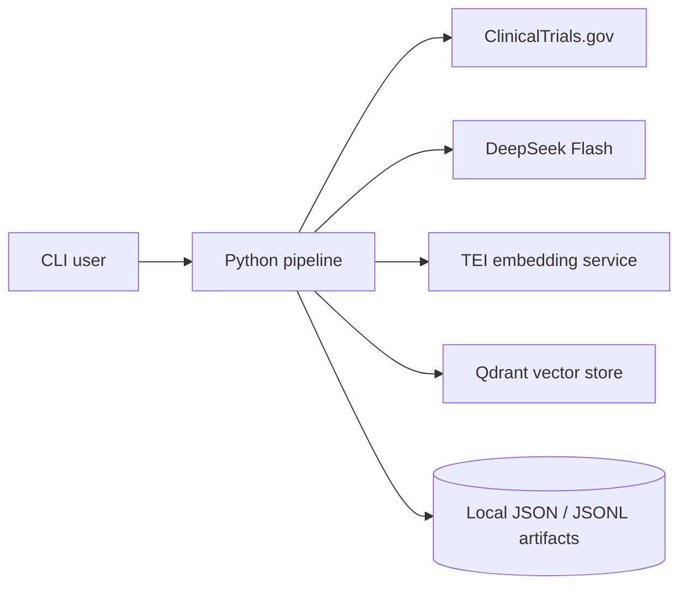

# Architecture Brief

**Status**: Current implementation through feature 007

**Last reviewed**: 2026-10-21

Clinical Doc Assist is a small evidence-grounded retrieval and question-answering
practice project. It discovers public ClinicalTrials.gov research records, builds a
local corpus, retrieves evidence, generates cited answers, evaluates the pipeline
against a fixed question set, and presents answers in a deterministic plain-text
format.

This is not a clinical decision-support system. It uses public research records
only and produces development-stage summaries of those records.

## 1. System boundary

The system has five runtime boundaries:

| Boundary | Responsibility |
| --- | --- |
| Host Python CLI | Orchestrates stages, validates inputs, writes local artifacts, and runs tests |
| ClinicalTrials.gov API | Supplies public study search results, details, and metadata |
| DeepSeek API | Supports discovery screening and evidence-grounded answer generation |
| TEI container | Converts evidence text into embeddings with `BAAI/bge-small-en-v1.5` |
| Qdrant container | Stores vectors and returns ranked evidence chunks |



The host process keeps framework code small. PyTorch and Transformers remain
inside the TEI container, and Qdrant runs as a local Docker service.

## 2. End-to-end data flow

```text
topic
  -> discovery run
  -> normalized corpus documents
  -> deterministic chunks
  -> embeddings and Qdrant points
  -> ranked retrieval evidence
  -> cited answer record
  -> linked pipeline record
  -> fixed-case evaluation
  -> plain-text presentation
```

Every arrow is represented by a persisted artifact. A user can stop after any
stage, inspect its output, and decide whether to continue.

## 3. Pipeline stages

| Stage | Command | Input | Output | Uses LLM | Uses Docker |
| --- | --- | --- | --- | --- | --- |
| Discovery and screening | `clinical-doc-discover` | Topic and date range | Discovery JSON | Yes | No |
| Corpus assembly | `clinical-doc-corpus build` | One or more discovery runs | `manifest.json`, `documents.jsonl`, `chunks.jsonl` | No | No |
| Indexing | `clinical-doc-retrieve index` | Corpus directory | Qdrant collection and index manifest | No | Yes |
| Retrieval | `clinical-doc-retrieve search` | Natural-language query | Ranked retrieval JSON | No | Yes |
| Answering | `clinical-doc-answer` | One retrieval artifact | Cited answer JSON | Yes | No |
| Orchestration | `clinical-doc-ask` | Question | Retrieval, answer, and pipeline artifacts | Yes | Yes |
| Evaluation | `clinical-doc-eval run` | Fixed cases plus saved or generated pipelines | Evaluation and verdict artifacts | Yes, in generated mode | Yes, in generated mode |
| Presentation | `clinical-doc-present` | Pipeline and optional verdicts | Plain-text view and metadata | No | No |

## 4. One-question request flow

`clinical-doc-ask` is the shortest end-to-end path:

1. The CLI receives a question, collection name, and retrieval limit.
2. The retrieval service embeds the question through TEI.
3. Qdrant returns the highest-ranked chunks for that collection.
4. The retrieval artifact records the query, ranking scores, text, NCT ID, section,
   URL, and content hash.
5. The answering service sends only the recorded question and evidence to DeepSeek
   Flash.
6. The model may request allowlisted trial metadata for an NCT ID that appears in
   the retrieved evidence.
7. The answering service validates every claim citation against the supplied
   evidence or a successful metadata lookup.
8. The answer service persists an answer record with claims, citations, tool calls,
   usage, latency, status, and errors.
9. The orchestration service writes a pipeline record linking the retrieval and
   answer artifact IDs and paths.

If evidence is missing, the preferred result is `insufficient_evidence`, not an
unsupported answer. If a stage fails, the pipeline record exposes the failure.

## 5. Module map

| Package | Main responsibility |
| --- | --- |
| `clinical_doc_assist.research` | Discover candidates, use current UTC time, screen sources, and persist discovery runs |
| `clinical_doc_assist.corpus` | Fetch study details, normalize documents, chunk sections, and create corpus manifests |
| `clinical_doc_assist.retrieval` | Embed corpus chunks, index Qdrant points, and search evidence |
| `clinical_doc_assist.answering` | Run the grounded answer agent, resolve citations, and persist answer records |
| `clinical_doc_assist.orchestration` | Compose retrieval and answering into one linked pipeline |
| `clinical_doc_assist.evaluation` | Calculate metrics, compare runs, create verdicts, review readability, and render text |

The package is intentionally separated by stage. Running-time answering does not
depend on evaluation code, and evaluation reads saved artifacts rather than
modifying them.

## 6. Artifact contracts

All durable boundaries use explicit local artifacts:

| Artifact | Default location | Purpose |
| --- | --- | --- |
| Discovery run | `artifacts/discovery/` | Accepted, rejected, and review candidates with screening reasons |
| Corpus manifest | `artifacts/corpus/<name>/manifest.json` | Corpus version, source state, failures, and chunk summary |
| Documents | `artifacts/corpus/<name>/documents.jsonl` | Normalized public research documents |
| Chunks | `artifacts/corpus/<name>/chunks.jsonl` | Stable chunk IDs and source-section metadata |
| Index manifest | `artifacts/index-runs/` | Collection, embedding model, dimensions, and indexed point count |
| Retrieval run | `artifacts/retrieval/` | Query, ranked evidence, scores, and canonical provenance |
| Answer record | `artifacts/answers/` | Validated claims, citations, tool calls, usage, and status |
| Pipeline record | `artifacts/pipelines/` | Links one retrieval artifact to one answer artifact |
| Evaluation run | `artifacts/evaluations/` | Per-case and aggregate metrics, configuration, and failure diagnoses |
| Presentation | `artifacts/presentations/` | Plain text plus machine-readable rendering metadata |

`artifacts/` is ignored by Git. Contracts and schemas are documented under each
feature directory in `specs/`.

## 7. Grounding and safety controls

The architecture uses several small controls instead of adding another agent:

- Discovery records the current UTC time and uses it in the search prompt.
- A deterministic screening layer rejects sources outside the allowlisted public
  source policy.
- Chunk IDs are deterministic, so retrieval and evaluation can refer to stable
  evidence units.
- The answer model receives only retrieved evidence and allowlisted metadata tools.
- Every factual claim must contain citation IDs.
- Retrieval citations must resolve to supplied chunks.
- Metadata citations must resolve to a successful lookup for an allowed NCT ID.
- The answer service can return `insufficient_evidence` or `failed`.
- Evaluation treats retrieval, citation, refusal, latency, and usage as separate
  measurements.
- Presentation never displays raw model output as authoritative answer prose.
- Presentation never turns an evaluation result into a per-answer trust percentage.

## 8. Evaluation architecture

The versioned pilot suite is
[`glp1-eval-v1.json`](../evaluation/cases/glp1-eval-v1.json). It contains 20 fixed
questions: answerable and unanswerable cases with expected evidence, key points,
and forbidden statements.

Evaluation can run in two modes:

| Mode | Behavior | Main purpose |
| --- | --- | --- |
| Saved | Reads a mapping from case IDs to existing pipeline artifacts | Fast, offline, deterministic replay |
| Generated | Invokes feature 006 for every case | Measures the current live stack |

The evaluator produces:

- Retrieval hit@k, recall@k, and mean reciprocal rank.
- Citation validity and citation coverage.
- Required-key-point and forbidden-statement checks.
- Refusal correctness.
- Latency and available token/cost usage.
- Failure codes and intervention categories.
- Exact-case verdicts linked to suite, rubric, configuration, pipeline, and answer.

A candidate comparison must match the case set and rubric versions and change
exactly one configuration variable. The baseline and limitations are recorded in
[`evaluation-baseline.md`](evaluation-baseline.md).

## 9. Configuration and runtime

Configuration is environment-based:

- DeepSeek credentials and model settings live in `.env`.
- TEI and Qdrant URLs live in `.env`.
- `.env` is ignored and must never be committed.
- Docker Compose starts TEI and Qdrant with localhost-only ports.
- Generated evaluation and end-to-end asking require both APIs and containers.
- Saved answering requires DeepSeek but not Docker.
- Saved evaluation, comparison, and presentation require only the local Python
  environment.

## 10. Failure boundaries

Failures are expected to remain visible and stage-specific:

- Discovery reports rejected and needs-review candidates.
- Corpus assembly can report a partial corpus while preserving successful records.
- Retrieval returns `no_results` or `failed` explicitly.
- Answer records preserve `errors`, `reason`, and status.
- Missing or malformed linked artifacts fail evaluation input validation.
- Quality failures are recorded per case without crashing a completed evaluation.
- Oversized complete presentations fail instead of dropping claims.

## 11. Deliberate simplifications

| Decision | Reason |
| --- | --- |
| One answering agent | Avoids coordination overhead before a measured bottleneck exists |
| Deterministic chunking | Easier to reproduce and debug than model-based chunking |
| Local TEI and Qdrant | Keeps vector operations small and avoids a hosted dependency |
| Local artifact files | Makes each stage inspectable and easy to replay |
| Deterministic baseline metrics | Cheap and transparent; no second judge model yet |
| Plain-text presentation | Stable, portable, and cannot invent new answer content |
| No trust percentage | Global benchmark results are not calibrated per-answer truth |

## 12. Known limitations

- Ingestion currently uses ClinicalTrials.gov records rather than arbitrary PDF and
  protocol parsing.
- Retrieval quality on the pilot suite is limited; the initial hit@k is 0.444.
- Key-point matching is a normalized text proxy, not semantic verification.
- The delegated readability review was AI-assisted, not an independent human
  review.
- Multi-source and conflicting-evidence presentation cases remain unverified.
- There is no API, CI pipeline, dashboard, reranker, OCR, or always-on monitoring.
- The project has not been validated for clinical use.

## 13. Related specifications

- [Baseline specification](../specs/001-clinical-documentation-agent/spec.md)
- [Architecture decision record](../specs/001-clinical-documentation-agent/architecture-review.md)
- [Discovery and screening](../specs/002-research-doc-discovery/spec.md)
- [Corpus chunking](../specs/003-evidence-corpus-chunking/spec.md)
- [Vector retrieval](../specs/004-evidence-vector-retrieval/spec.md)
- [Evidence-grounded answers](../specs/005-evidence-grounded-answers/spec.md)
- [Question-to-answer orchestration](../specs/006-question-answer-orchestration/spec.md)
- [Evaluation and presentation](../specs/007-rag-evaluation/spec.md)
